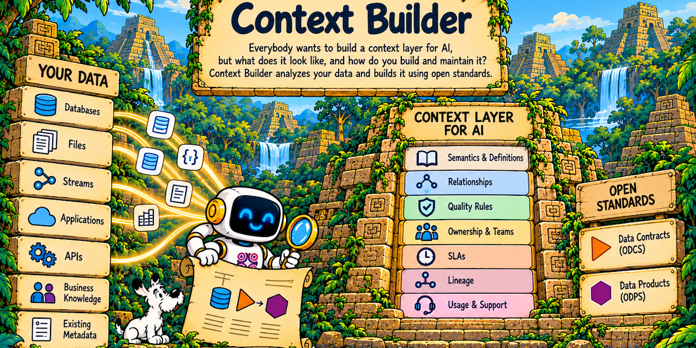

# Context Builder

▶ [Watch the demo: Creating the context layer using ODCS and ODPS](https://youtu.be/Rg0gxIELAkU)



Everybody wants to build a context layer for AI, but what does it look like, and how do you build and maintain it? Context Builder analyzes your Snowflake data and builds it using open standards.

**From Snowflake schema to AI-ready data product.** Pick a database, tick the schemas and tables, and Context Builder:

1. **Generates** one [ODCS v3.2](https://github.com/bitol-io/open-data-contract-standard) data contract per schema and bundles them as the output ports of an [ODPS v1.1](https://github.com/bitol-io/open-data-product-standard) data product.
2. **Profiles** the data with bounded SQL (sampled, one aggregate pass per table).
3. **Asks Snowflake Cortex** (`AI_COMPLETE`) to propose the semantic layer: descriptions, business names, PII classification, tags, data-quality rules and SLAs (collectively named [Data QoS](https://medium.com/data-mesh-learning/what-is-data-qos-and-why-is-it-critical-c524b81e3cc1)). Primary keys are proposed from profile evidence.
4. **Keeps a human in the loop**: nothing reaches a contract until you accept (or edit) it.
5. **Proves the rules**: every quality rule runs against Snowflake and shows pass/fail with the exact SQL.
6. **Publishes**: saves the product, its contracts and the semantic model in Snowflake, and exports to **OSI/Apache Ossie** for BI and AI tools.

ODCS and ODPS are the source of truth; the OSI/Apache Ossie model is derived from them, one way.

_Built for the Data in the D hackathon. Repository: `ai.jgp.hackathon.snowflake`, project code DIND._

## Try it

**https://tools.actianlabs.com/contextbuilder/**

Judges: sign in with **`jgp` / `odcs`**. The demo profile comes with a Snowflake connection to the hackathon lab account; you can change it under **Snowflake connection** in the header.

A 3-minute walkthrough is in [`doc/DEMO.md`](doc/DEMO.md). The Devpost story, with each
challenge linked to the CHANGELOG entry that records the fix, is in
[`doc/SUBMISSION.md`](doc/SUBMISSION.md).

## What it produced on the lab data

Live runs against the hackathon's `FINSERV_DW` on 2026-10-16 (synthetic data provided by the organizers):

| Run | Result |
|---|---|
| `INSURANCE` (CLAIMS 9,740 rows, POLICIES 35,000 rows) | 104 Cortex proposals in 30 s, no warnings |
| Same, after accepting all proposals | contract still valid against the ODCS v3.2.0 JSON schema |
| Quality rules proposed by Cortex, run on the data | 12 of 12 pass, about 1 s |
| `CORE` (4 tables) | proposals in 40 s, including primary keys such as `ACCOUNT_ID` (no nulls, ~82,699 distinct in 83,614 rows) |

Cortex rediscovered invariants the dataset authors had planted, without being told about them, for example *"a claim cannot be reported before the incident occurred"* (`SELECT COUNT(*) FROM ${table} WHERE REPORTED_DATE < INCIDENT_DATE`, must be 0) and *"effective date precedes expiration date"* on policies.

## How it maps

| Snowflake | Standard |
|---|---|
| Database | ODPS v1.1.0 data product |
| Schema | ODCS v3.2.0 data contract, exposed as one output port (`contractId`) |
| Table or view | contract `schema[]` object, columns as `properties[]` |
| Accepted proposals | `description`, `businessName`, `classification`, `tags`, `quality[]`, `slaProperties[]`, `primaryKey` |
| Contracts | OSI/Apache Ossie `datasets[]`, fields, primary keys, inferred `relationships[]`; classification and quality ride along in an `ODCS` custom extension |

Every generated document is validated against the official JSON schemas, bundled in `backend/src/main/resources/standards/` (ODCS v3.2.0, ODPS v1.1.0, Apache Ossie core `0.2.0.dev0`).

## Architecture

```
React (Vite) ──/contextbuilder/api──▶ Spring Boot 4 (Java 21) ──JDBC──▶ Snowflake
                                        ├─ catalog      INFORMATION_SCHEMA, SHOW ... KEYS
                                        ├─ profile      sampled aggregate SQL
                                        ├─ enrich       AI_COMPLETE, one call per table, 4 in parallel
                                        ├─ quality      ODCS rules compiled to read-only SQL
                                        ├─ store        <db>.DATA_PRODUCTS.ARTIFACTS (YAML + VARIANT, one row per artifact)
                                        └─ osi          OSI/Apache Ossie export
```

- **Per-user Snowflake connections.** Users sign in, then set their Snowflake account, user, password, warehouse, role and save database in their profile. Each user gets their own small connection pool; the password is write-only and never returned or logged.
- **Safe by construction.** Object names are validated and quoted; profiling is sampled and bounded; SQL quality rules must be a single read-only `SELECT`; a stored document is never overwritten, and a save can only be deleted whole, by an explicit confirmation.
- **Defensive AI.** Cortex answers are parsed leniently, retried once if malformed, reduced to valid ODCS, and dropped if they reference columns that do not exist.

## Run it locally

Two terminals.

```bash
# backend on :8080; 'local' serves a FINSERV_DW-shaped stub, no Snowflake needed
cd backend && ./mvnw spring-boot:run -Dspring-boot.run.profiles=local

# frontend on :5173
cd frontend && npm install && npm run dev
```

Open <http://localhost:5173/contextbuilder/> and sign in with `jgp` / `odcs`.

Against real Snowflake, start the backend without the `local` profile. Optionally pre-fill the demo user's connection with `backend/.env` (gitignored):

```properties
SNOWFLAKE_ACCOUNT=<orgname-accountname>
SNOWFLAKE_USER=<user>
SNOWFLAKE_PASSWORD=<password>
SNOWFLAKE_WAREHOUSE=<warehouse>
SNOWFLAKE_DATABASE=<database where products are saved>
CORTEX_MODEL=claude-sonnet-5
```

The role needs `USE AI FUNCTIONS` and `CORTEX_USER` (or `AI_FUNCTIONS_USER`) to call Cortex, read access to the data, and `CREATE SCHEMA` on the save database.

No backend at all: `cd frontend && npm run dev:mock`.

## API

| Endpoint | Purpose |
|---|---|
| `GET /api/auth/demo`, `POST /api/auth/login`, `POST /api/auth/logout`, `GET /api/auth/me` | sign-in |
| `GET` / `PUT /api/me/connection` | the user's Snowflake connection (tested before saving) |
| `GET /api/catalog/databases[/{db}/schemas[/{schema}/tables]]` | catalog |
| `POST /api/profile` | bounded profile of selected tables |
| `POST /api/products/generate`, `POST /api/products/yaml` | ODCS + ODPS generation, YAML |
| `POST /api/enrich`, `POST /api/products/apply` | Cortex proposals, apply the accepted ones |
| `POST /api/quality/run` | execute quality rules |
| `POST /api/products/save`, `GET /api/products[/{id}]` | store in Snowflake, list, reload |
| `POST /api/export/osi` | OSI/Apache Ossie export |

## Tests

```bash
cd backend && ./mvnw verify      # tests + JaCoCo gate (60% minimum)
cd frontend && npm run lint && npm run build
```

## Deploy

Manual, by design: see [`deploy/README.md`](deploy/README.md).
